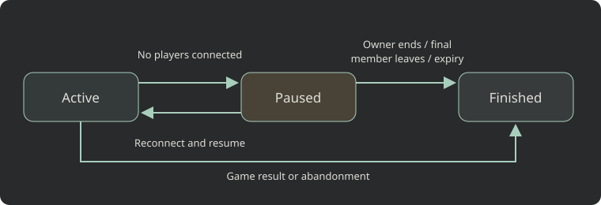

# Sessions, worlds, and recovery

An authoritative session is created through matchmaking, invite acceptance, practice, or the start
of a realtime room with a server backend. A room is a lobby with seats; its `gameSessionId` identifies
the separate session running gameplay. See [Games](api/games.md) and [Realtime rooms](api/realtime.md).

## Lifecycle



`status` is `active` or `finished`. Pausing does not introduce a third status: `pausedAt` marks a
paused persistent session. A finished session cannot be played again. Replays, if enabled, are read
through their own endpoints.

| Event | Ordinary match | Persistent session |
|---|---|---|
| Last gameplay socket disconnects | Ends after about 5 minutes without return | Pauses after about 15 seconds |
| No player activity for 24 hours | Can be retired | Pauses rather than ending for inactivity |
| Player requests another session | Can retire an empty older match | Does not retire their parked worlds |
| Player reconnects | Only while still active | Resumes before the first command |
| Backend returns a result | Finishes | Finishes |
| Owner ends the session | Finishes without a winner/rating change | Same |

Timing and recovery limits can vary by deployment. Paused worlds count against the per-player
concurrent-session limit. Offer a way to explicitly leave or finish worlds.

## Disconnecting and leaving are different

Closing a socket preserves membership so the player can return. An explicit **Leave world** gives
up membership and access to its gameplay socket.

For a persistent session **without a room**:

```http
POST /api/v1/games/{slug}/sessions/{sessionId}/leave
Authorization: Bearer <player-token>
```

There is no request body. Success is `204`. The game is notified of the membership change and the
leaver's gameplay sockets close. When the last human member leaves, the world ends with
`players_left`. `404` means no session, `403` means not a member, `410` means already ended, and
`409` means this is not a persistent world or it belongs to a room.

For a **room-bound session**, use `POST /api/v1/realtime/rooms/{roomId}/leave`. In a
join-in-progress room this vacates the seat and removes session membership. In a fixed-roster match,
the seat becomes AI and the session may retain its original membership. Follow the room's rules;
do not call the standalone session-leave endpoint.

A running join-in-progress world can stay listed after its last visitor leaves. A member of a
persistent world can also use another ordinary lobby. Discover current memberships through
`GET /api/v1/realtime/rooms/joined`, not just `/rooms/mine`.

## Read recovery information

Players in the session and the game's owner can call:

```http
GET /api/v1/games/{slug}/sessions/{sessionId}/recovery
Authorization: Bearer <player-or-owner-token>
```

The response describes this session's effective recovery and transport limits:

| Fields | Meaning / unit |
|---|---|
| `sessionId`, `status`, `runtime`, `persistent` | Session identity and type; runtime is `script` or `container` |
| `pausedAt`, `pausedMillis` | Pause start ISO timestamp; accumulated paused time in milliseconds |
| `snapshotBytes`, `stateBudgetBytes`, `lastSnapshotAt` | Recovery document size/budget in bytes and latest snapshot ISO time |
| `snapshotIntervalSeconds`, `maxSnapshotPushHz` | Container checkpoint cadence and push ceiling; `null` for scripts |
| `maxRestoreStalenessSeconds` | Container match's maximum snapshot age; `null` where not applicable, including persistent worlds |
| `maxRestores`, `restoreWindowMinutes`, `restoreCount` | Recovery attempt allowance, its window, and the reported restore count |
| `retentionDays`, `recoveryDataExpiresAt` | Paused-world retention; `0` and `null` mean no configured expiry |
| `transport.maxMessageBytes`, `transport.maxRealtimeInputsPerSecond` | Gameplay frame/input limits |
| `transport.tickRateHz`, `transport.pacingRateHz` | Effective tick and transport pacing rates in Hz |

Read these values instead of promising indefinite retention or a fixed crash-rewind window. A
positive `retentionDays` allows a paused world to expire. Display `recoveryDataExpiresAt` when set;
expiry finishes the session with `retention_expired`.

## Restoring client and server state

On a socket reconnect, request your game's full-state message. On `resumed`, discard interpolation
and prediction based on the earlier state; `lostMs` reports the recovery gap. Do not assume a move
whose acknowledgement was lost is safe to resend.

Scripts return complete state documents. Containers must rebuild a whole session from a snapshot
and current roster, including players admitted since an earlier snapshot. Push checkpoints after
important events, within the reported ceiling. A pause removes a container's live session and later
recreates it from its saved snapshot. Paused game time can use `ctx.now - ctx.pausedMs`.

A failed resume leaves the world paused and closes the socket after an error; back off and retry.
A failed recovery can instead finish a session. Terminal `abandoned` reasons include `players_left`,
`idle_no_players`, `superseded`, `server_failure`, `restore_failed`, `operator_ended`, and
`retention_expired`. Show the reason and stop reconnecting. Abandonment grants no winner or Elo change.

See [persistent sessions](tutorials/persistent-sessions.md) for server code and
[troubleshooting](troubleshooting.md#websockets) for reconnect decisions.
