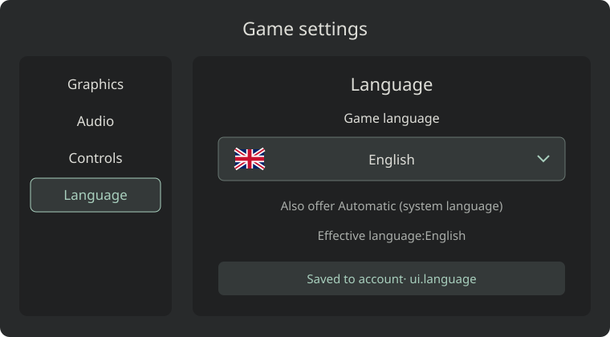

# Tutorial: localize your game and add language settings

Give your game a **Language** section in its settings menu, alongside
[Graphics](graphics-options.md), [Audio](audio-options.md), and [Controls](game-controls.md).
Make it available from the main menu and during play. Use the same language set and image-based
flag selector as the StarHermit website and developer wiki. These are game-side recommendations;
StarHermit stores your preference but does not translate the game or supply a built-in language menu.

## Supported languages and labels

Start with the following ten languages. This matches the wiki's total-speaker selection; it is a
starting set, not a requirement to remove other translations your game supports. Only list languages
whose menus, gameplay text, and fonts you actually ship.

| Locale key | Label shown to players | Direction | Flag asset |
|---|---|---|---|
| `en` | `English` | Left to right | [United Kingdom](../../assets/flags/gb.svg) |
| `zh-CN` | `简体中文` | Left to right | [China](../../assets/flags/cn.svg) |
| `hi` | `हिन्दी` | Left to right | [India](../../assets/flags/in.svg) |
| `es` | `Español` | Left to right | [Spain](../../assets/flags/es.svg) |
| `ar` | `العربية` | Right to left | [Saudi Arabia](../../assets/flags/sa.svg) |
| `fr` | `Français` | Left to right | [France](../../assets/flags/fr.svg) |
| `bn` | `বাংলা` | Left to right | [Bangladesh](../../assets/flags/bd.svg) |
| `pt` | `Português` | Left to right | [Brazil](../../assets/flags/br.svg) |
| `id` | `Bahasa Indonesia` | Left to right | [Indonesia](../../assets/flags/id.svg) |
| `ur` | `اردو` | Right to left | [Pakistan](../../assets/flags/pk.svg) |

Show each language's native name. Flags are supplementary visual cues: countries and languages
are not interchangeable, and many languages are spoken in several countries. Keep the text label
visible. Use small local **SVG or PNG images**, not flag emoji: some devices display emoji flags as
country codes. Copy these assets into your build rather than depending on the wiki at runtime.

Declare each translation's actual regional coverage. For example, `zh-CN` here is Simplified Chinese
and the Portuguese flag is a Brazil cue. A `pt-BR`-specific pack should be identified accordingly;
ship separate `pt-PT` or Traditional Chinese packs when you support those variants.

## Put the choice in the settings menu



Use **Settings → Language → Game language**. Include **Automatic (system language)** and show its
resolved language, such as **Automatic — English**. Keep the current choice visible when the
selector is closed. The diagram shows an explicit English selection.

The section should offer the following behavior:

- Apply changes immediately to menus, HUD, tutorials, tooltips, accessibility labels, and future
  notifications. Refresh visible text without restarting the match, discarding progress, or
  reconnecting sockets. Keep focus on the language control after selection.
- Use a keyboard-accessible dropdown or disclosure, with visible focus, touch targets, and a
  scrollable list. Support the game's controller navigation as well. Close on Escape and outside
  clicks; keep native language names readable even when the rest of the interface changes.
- Keep **Automatic** distinct from an explicit choice. Store `auto`, not the detected language, so
  another device can use its own system language. An explicit choice must win over detection.
- Show the effective language and persistence state: **Saved to account**, **Saved on this device**,
  or **Account sync unavailable**. Translate these messages too; do not report a failed upload as saved.

For a browser game, a disclosure with real flag images can look like this. Copy the flags into
`flags/` next to your game, and populate the remaining choices from the table above:

```html
<section aria-labelledby="language-heading">
  <h2 id="language-heading" data-i18n="settings.language">Language</h2>
  <label id="game-language-label" data-i18n="settings.gameLanguage">Game language</label>
  <details id="game-language-picker">
    <summary aria-labelledby="game-language-label current-language">
      
      <span id="current-language" lang="en" dir="auto">English</span>
    </summary>
    <div aria-labelledby="game-language-label">
      <button type="button" data-language="auto" data-i18n="settings.automatic">
        Automatic (system language)
      </button>
      <button type="button" data-language="en">
        
        <span lang="en" dir="auto">English</span>
      </button>
      <button type="button" data-language="ar">
        
        <span lang="ar" dir="auto">العربية</span>
      </button>
    </div>
  </details>
  <p id="language-sync" role="status" aria-live="polite"></p>
</section>
```

Wire `data-language` to your translation renderer and preference store. Update the summary image,
name, selected-state indication, and status text together; close the disclosure and return focus to
its summary. Give buttons a selected-state indicator and meaningful accessible names. Keep the flag
images at their small fixed size: broad styling for diagram SVGs must not enlarge them.

## Translation packs and fallback

Keep player-facing text in versioned packs with stable keys, for example
`locales/en.json`, `locales/ar.json`, and `locales/zh-CN.json`. Make English the complete source pack.
Translate messages as whole units, retaining named placeholders; avoid joining translated sentence
fragments or inserting user data into translation source strings.

```json
{
  "settings.language": "Language",
  "settings.gameLanguage": "Game language",
  "settings.automatic": "Automatic (system language)",
  "settings.saved": "Saved to account",
  "hud.coins": "{count} coins"
}
```

The last entry illustrates a stable key and placeholder; use a plural-aware message formatter for
real count messages. Languages have different plural rules. Format numbers, dates, times, and
currencies with the selected locale rather than hard-coded separators or word order. Keep time
units, currency amounts, and game rules unchanged.

Resolve the language in this order:

1. A valid explicit choice from the player's game settings, or their current unsynced choice.
2. For `auto`, the first supported match from the device's language preferences.
3. English when no supported match exists; also fall back to English for individual missing keys.

Match locale tags case-insensitively, preferring an exact supported region/script before a configured
base-language fallback. Map generic `zh` or `zh-Hans` to the Simplified pack only when that is your
published policy; do not present a Simplified-only pack as support for `zh-Hant`. An unsupported or
malformed stored choice should fall back safely. Missing English source keys should fail validation
before publication rather than leave blank buttons.

Generate translations during development and ship the packs with the game. Machine translation can
produce a first draft; review terminology, instructions, and important player-facing messages before
calling a language fully supported. Mark unreviewed translations as machine-generated and offer an
English fallback. Keep placeholders, game titles, API routes, IDs, error codes, save keys, and protocol
values intact. Translate an error code's displayed explanation, not the code used by your logic.

## Right-to-left text, fonts, and gameplay

For Arabic and Urdu, set the interface language and direction on the UI root. In a browser, for example:

```js
document.documentElement.lang = effectiveLocale;
document.documentElement.dir = ['ar', 'ur'].includes(effectiveLocale) ? 'rtl' : 'ltr';
```

Use logical CSS properties such as `margin-inline-start`, `padding-inline-end`, and `text-align: start`.
Mirror appropriate interface navigation and alignment, while preserving the meaning of gameplay
coordinates, directional controls, world maps, and movement indicators. Keep technical tokens and
code displays left to right; isolate player names and mixed-direction values with `<bdi>` or your
engine's equivalent. Do not translate player-authored chat, names, or game commands automatically.

Ship fonts with the required Chinese, Devanagari, Bengali, Arabic, and Urdu glyphs and shaping support.
Check connected Arabic letters, combining marks, line height, and wrapping in your actual renderer.
For canvas or engine HUDs, use its supported shaping and bidirectional-text path; HTML `dir` alone
cannot fix a renderer that treats text as unrelated glyphs. Allow longer labels and subtitles to wrap.
Refresh text through render hooks when the language changes, avoiding a full UI scan every frame.

## Save the choice through StarHermit

Use the game's [per-player settings](../api/games.md#per-player-game-settings), not cloud-save progress
or an account-wide profile field. A player launch token can read and write settings for its own game;
this does not need a gameplay server or a manifest language declaration.

A suggested game-owned key is `ui.language`, with a value such as `{ "choice": "fr" }` or
`{ "choice": "auto" }`. These names are your convention, not reserved platform fields. Read and
validate the settings before writing. Use an individual-key update so Graphics, Audio, and Controls
preferences are preserved.

With the [browser SDK](../sdk/javascript.md), after `StarHermit.init()` and the normal sign-in/terms flow:

```js
const supported = new Set(['en', 'zh-CN', 'hi', 'es', 'ar', 'fr', 'bn', 'pt', 'id', 'ur']);
const validChoice = choice => choice === 'auto' || supported.has(choice);
const settingsPath = `/api/v1/games/${encodeURIComponent(StarHermit.slug)}/settings`;

// Run only when StarHermit.signedIn; unsigned play uses no authenticated requests.
const response = await StarHermit.api(settingsPath);
if (!response || !response.settings || Array.isArray(response.settings) ||
    typeof response.settings !== 'object') {
  throw new Error('Settings could not be loaded'); // Keep account writes blocked.
}
const stored = response.settings['ui.language'];
const choice = validChoice(stored?.choice) ? stored.choice : 'auto';

// Later, on an explicit language change, after a successful settings read:
const nextChoice = 'fr'; // Your selector's validated value.
if (!validChoice(nextChoice)) throw new Error('Unsupported language choice');
const saved = await StarHermit.api(`${settingsPath}/ui.language`, {
  method: 'PUT', body: { value: { choice: nextChoice } },
});
if (!saved) throw new Error('Language preference was not acknowledged');
```

`StarHermit.api` rejects most failures but resolves `null` on `404`, `204`, or signed-out calls;
the example checks for missing settings and an unacknowledged key update. The convenience
`getSettings()` and `setSetting()` helpers soften errors to fallback values, so use the raw API when
distinguishing a failed read or write from success matters. An empty successful `settings` map is a
new preference; a failed request is not.

Apply the selected language locally even if account sync fails, retain the pending choice, and offer
retry after a successful settings read. Serialize writes so rapid selections cannot save an older
choice last. Reinitialize and fence pending sync work when the signed-in player changes. Keep any
local preference cache scoped to the game and player, with a separate guest scope; store preferences
separately from progress. In untracked play, do not call account APIs, and follow your guest-mode
policy for local preference storage. Never upload defaults just because a read failed.

## Verify before publishing

Test every supported language on desktop and a narrow touch screen, including all start-screen
variants, pause/settings menus, dynamic HUD messages, dialogs, tutorials, and error paths. Verify
SVG flags on a device that lacks emoji-flag support, keyboard/controller selection, saved explicit
choices, and Automatic on a device with a different system language. Test Arabic/Urdu shaping and
mixed-direction player names, long labels, plural counts, missing keys/fonts, unavailable storage,
failed account reads/writes, rapid selections, and account switching. Language changes must leave
progress, match state, and gameplay connections intact.

See also: [Graphics](graphics-options.md) · [Audio](audio-options.md) ·
[Controls](game-controls.md) · [JavaScript SDK](../sdk/javascript.md).
